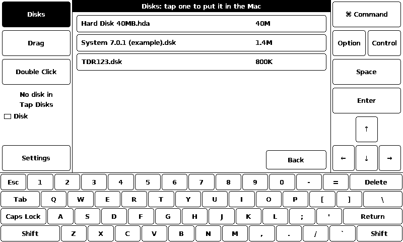

# Web Flasher
[CYD-MacSE Web Flasher for 5.0" S3 CYD](https://tomtombombadil.github.io/CYD-MacSE/)

# CYD Mac SE

A Macintosh SE emulator for the **Freenove 5.0" ESP32-S3 display**
(FNK0115Q, 800x480 RGB IPS, GT911 capacitive touch; also sold as the
Hosyond 5" ESP32-S3 800x480, the same board). It runs
[Mini vMac](https://github.com/minivmac/minivmac) set up as a Mac SE with
4 MB of RAM, and takes floppy and hard disk images from the microSD card.

**Status: 0.1.0, not yet run on a board.** It builds, and the PC test
build runs the emulator and the touch screen code (see Testing).



## What you need

- The board (ESP32-S3-WROOM-1 **N16R8**: 16 MB flash, 8 MB PSRAM).
- A microSD card formatted **FAT32**.
- **Your own Mac SE ROM**, 256 KB, named `MacSE.ROM`. It must be the
  original Mac SE ROM (its first four bytes are `B2 E3 62 A8`). The SE
  FDHD and Classic ROMs don't work with this emulator core. ROMs are
  Apple's: none comes with this project.
- Disk images: a System disk (System 6.0.8 or System 7.0.1 suit an SE
  with 4 MB) and whatever programs and games you want.

## The SD card

Make a folder named `mac` at the card's root and put everything in it:

```
mac\
  MacSE.ROM
  System 7.0.1.dsk
  The Dungeon Revealed.dsk
  Hard Disk.hda
```

The emulator lists every file of 400 KB or more in that folder (and the
card's root) on its **Disks** page. It reads:

- floppy images: 400K, 800K and **1.44 MB** raw images (`.dsk`, `.img`)
  and Disk Copy 4.2 images (`.image`). 1.44 MB disks work on this SE
  because Mini vMac replaces the Mac's floppy driver with its own, which
  takes a disk image of any size: no SuperDrive is emulated or needed.
- hard disk images: a bare HFS volume of any size up to 2 GB (`.dsk`,
  `.hfv`, as Mini vMac and Basilisk II make them), or a partitioned SCSI
  disk image (`.hda` from BlueSCSI / SCSI2SD, or any image with an Apple
  partition map): the first HFS partition is used.

Up to 6 disks can be in at once. What the Mac writes goes straight to the
image file on the card. The emulator keeps its settings and the list of
inserted disks in `mac\macse.txt` and puts those disks back in at the next
start, so a Mac with its System disk in boots by itself.

The board also writes its log to the card: `mac\log.txt` (this start),
`mac\log-old.txt` (the start before) and, after a crash, `mac\crash.txt`.
The board's USB port can't show the card to a PC (it is a serial chip),
so to read them put the card in a card reader.

## Using it

The Mac's screen is shown 1:1 (512x342) at the top middle, the keyboard
below, and keys on both sides.

- **Mouse**: tap the Mac's screen to move the pointer there and click.
  Press and move to drag (small wobbles of a firm stylus are ignored).
- **Menus**: tap a menu title and the menu stays open; tap the item you
  want.
- **Drag**: tap Drag, then tap where the drag starts (the button goes
  down there), then tap where it ends (it moves there and lets go). For
  moving icons and windows without dragging the stylus.
- **Double Click**: tap it, then tap the place to double-click.
- **Shift, Command, Option, Control** stay down until the next key or
  click (Command then Q quits). **Caps Lock** stays down until tapped
  again.
- **Disks**: the disk images on the card; tap one to put it in the Mac.
  Eject disks the Mac's way (drag to the Trash, or Put Away).
- **Settings**: Left Handed (swaps the two side panels), Sound, Speed
  (1x is a real SE; 2x / 4x / Max if the board is fast enough), Restart
  the Mac.

## Building and flashing (Windows)

1. Install VS Code and its PlatformIO extension.
2. Open this folder in VS Code (File > Open Folder).
3. In the status bar pick the environment `env:fnk50_rgb_cap`.
4. Plug the board in by USB, then click the arrow (Upload) in the status
   bar. The first build downloads ESP-IDF and takes a few minutes.

Every push also builds the firmware on GitHub (Actions > Build > the
`fw-fnk50_rgb_cap` artifact): `CYD-MacSE_5.0in_RGB_Capacitive.bin` is the
whole flash image, written at address 0x0.

## Not done / guesses

- **Speed on the board is unknown.** The emulated 68000 runs from PSRAM;
  if it can't keep up with a real SE the Mac just runs slower.
- No clock chip on the board: the Mac's date starts at 25 Nov 2026 each
  time. PRAM (Control Panel settings) isn't kept over a restart.
- Not emulated: the serial ports, SCSI (hard disks go through Mini vMac's
  disk driver instead), AppleTalk.
- The touch controller's INT pin is also the amplifier's LRCLK (the
  board's wiring): the sound may click while the screen is touched.

## Testing (PC)

`host/` builds the same emulator glue and touch UI for Linux or macOS
with a stand-in board that takes scripted taps and saves screenshots.
`sh host/test.sh` runs it on a stand-in ROM (`tools/make_test_rom.py`:
a few 68000 instructions with the SE ROM's checksum, no Apple code) and
checks the CPU, the screen copy and the 60 Hz timing. CI runs it on every
push.

## Licence

GPL version 2 (see `LICENSE`): Mini vMac is GPL 2 and the firmware is
built with it. See `THIRD_PARTY_NOTICES.md`.
